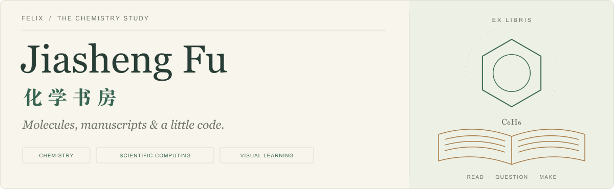
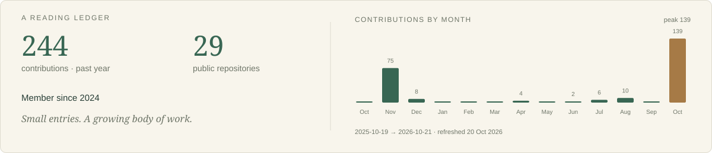
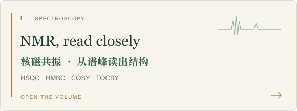
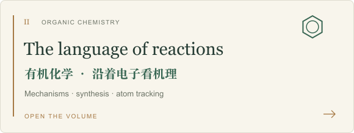
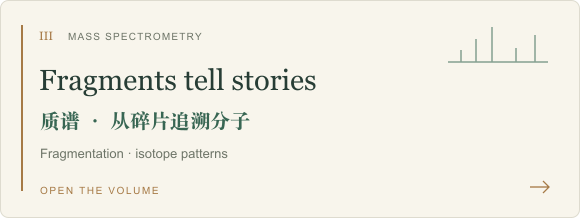
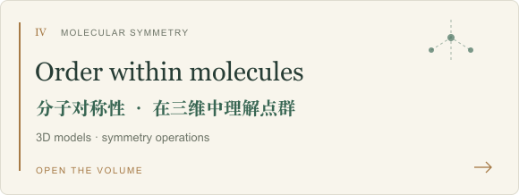
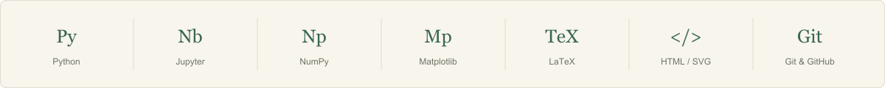

<!-- Static artwork is kept in this repository. Daily contribution artwork is refreshed by GitHub Actions. -->

<picture>
  <source media="(prefers-color-scheme: dark)" srcset="./assets/header-dark.svg">
  <source media="(prefers-color-scheme: light)" srcset="./assets/header-light.svg">
  
</picture>

  <b>Chemistry, explained with care.</b> 
  I turn chemistry, mathematics and physics into visual explanations, 
  interactive experiments and carefully written notes. 
  以书为径，以化学为趣，把抽象的科学讲得清楚一点。

<picture>
  <source media="(prefers-color-scheme: dark)" srcset="./assets/ledger-dark.svg">
  <source media="(prefers-color-scheme: light)" srcset="./assets/ledger-light.svg">
  
</picture>

## The bookshelf · 化学书架

Open a volume. Follow a spectrum, a mechanism, or a question.

<table>
<tr>
<td width="50%"><a href="https://github.com/FelixJiashengFu/NMR-Graph"><picture>
  <source media="(prefers-color-scheme: dark)" srcset="./assets/volume-nmr-dark.svg">
  <source media="(prefers-color-scheme: light)" srcset="./assets/volume-nmr-light.svg">
  
</picture></a></td>
<td width="50%"><a href="https://github.com/FelixJiashengFu/Organic-Chemistry-Graph"><picture>
  <source media="(prefers-color-scheme: dark)" srcset="./assets/volume-organic-dark.svg">
  <source media="(prefers-color-scheme: light)" srcset="./assets/volume-organic-light.svg">
  
</picture></a></td>
</tr>
<tr>
<td width="50%"><a href="https://github.com/FelixJiashengFu/mass-spectrometry"><picture>
  <source media="(prefers-color-scheme: dark)" srcset="./assets/volume-mass-dark.svg">
  <source media="(prefers-color-scheme: light)" srcset="./assets/volume-mass-light.svg">
  
</picture></a></td>
<td width="50%"><a href="https://github.com/FelixJiashengFu/Molecular-Symmetry-Graph"><picture>
  <source media="(prefers-color-scheme: dark)" srcset="./assets/volume-symmetry-dark.svg">
  <source media="(prefers-color-scheme: light)" srcset="./assets/volume-symmetry-light.svg">
  
</picture></a></td>
</tr>
</table>

  <a href="https://github.com/FelixJiashengFu/NMR-Graph">NMR</a> ·
  <a href="https://github.com/FelixJiashengFu/Organic-Chemistry-Graph">Organic chemistry</a> ·
  <a href="https://github.com/FelixJiashengFu/mass-spectrometry">Mass spectrometry</a> ·
  <a href="https://github.com/FelixJiashengFu/Molecular-Symmetry-Graph">Molecular symmetry</a>

### Notes in the margins · 数理札记

<a href="https://github.com/FelixJiashengFu/Complex-Analysis-Graph">Complex analysis</a> &nbsp; / &nbsp; <a href="https://github.com/FelixJiashengFu/pde-visualization">PDE visualizations</a> &nbsp; / &nbsp; <a href="https://github.com/FelixJiashengFu/statistical-mechanics">Statistical mechanics</a> &nbsp; / &nbsp; <a href="https://github.com/FelixJiashengFu/PHYB57-Study-Library">PHYB57 study library</a>

## On my desk · 案头工具

<picture>
  <source media="(prefers-color-scheme: dark)" srcset="./assets/toolkit-dark.svg">
  <source media="(prefers-color-scheme: light)" srcset="./assets/toolkit-light.svg">
  
</picture>

## A living trail · 贡献游踪

A copper-coloured snake wanders through a year of real GitHub contributions.

<picture>
  <source media="(prefers-color-scheme: dark)" srcset="./assets/snake-dark.svg">
  <source media="(prefers-color-scheme: light)" srcset="./assets/snake-light.svg">
  
</picture>

  <i>Read deeply. Experiment gently. Make things clear.</i> 
  读书，求证，让理解慢慢生长。

<a href="https://github.com/FelixJiashengFu?tab=repositories">Browse all volumes ↗</a> &nbsp; · &nbsp; Contribution animation by <a href="https://github.com/Platane/snk">Platane/snk</a>

